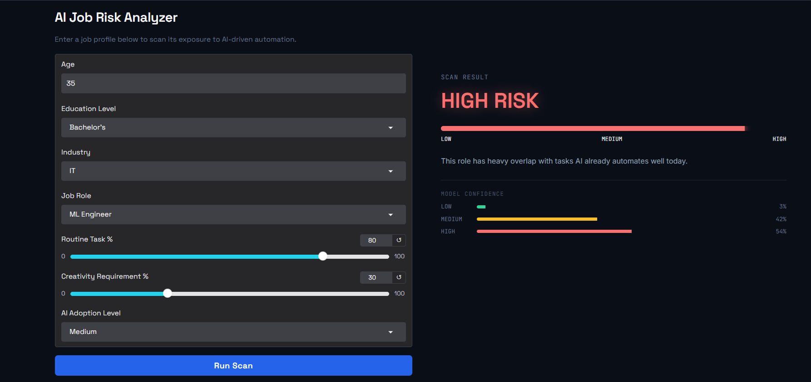
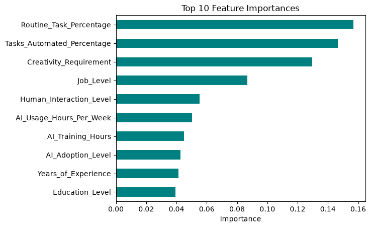
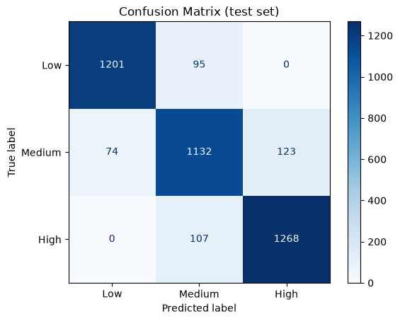

# AI Job Risk Analyzer

Predicts whether a job profile has a **Low, Medium or High** risk of AI-driven layoffs, using a Random Forest classifier. Comes with a dark, glassmorphism-style Gradio web app.



## What it does

You enter a job profile (age, education, industry, job role, routine task %, creativity requirement %, AI adoption level). The app shows:

- the predicted risk level (Low / Medium / High)
- a short explanation
- the model's confidence for each of the three classes

## Model

| Item | Details |
|------|---------|
| Algorithm | Random Forest Classifier (300 trees) |
| Task | 3-class classification (Low / Medium / High layoff risk) |
| Split | 80% train, 20% test (4,000 test rows) |
| Accuracy | ~90% on the test set |

## Key findings



- The model relies most on how routine a job is (`Routine_Task_Percentage`), how much of it is already automated (`Tasks_Automated_Percentage`), and how much creativity it needs (`Creativity_Requirement`). `Job_Level` comes next.



- 3,601 of the 4,000 test rows are predicted correctly.
- Mistakes only happen between neighbouring levels. No Low-risk job was predicted as High, and no High-risk job as Low. Medium is the hardest class to get right.

## Dataset

Kaggle: *AI Impact on Jobs and Layoff Risk* (search this title on Kaggle).

This is a **synthetic** dataset, so the ~90% accuracy shows the model learns the patterns in this data. It is not a claim about real-world layoffs.

The dataset is not included in this repo. Download it from Kaggle and upload it when the notebook asks.

## How the data was prepared

- Ordered columns (Education Level, Company Size, Job Level, AI Adoption Level) were mapped to numbers in their natural order, e.g. `Low = 0, Medium = 1, High = 2`.
- Unordered columns (Industry, Job Role) were one-hot encoded.
- The target `Layoff_Risk` was mapped to `0 / 1 / 2`.
- The app only asks for 7 inputs. The remaining features are filled with their average values from the training data.

## Run it

1. Open `layoff_risk_model.ipynb` in [Google Colab](https://colab.research.google.com/).
2. Run the cells from the top. Upload the Kaggle CSV when asked.
3. Run the last cell to launch the Gradio app.

Or locally:

```bash
pip install -r requirements.txt
```

Then replace the Colab upload cell with a normal `pd.read_csv("ai-impact-jobs-layoff-risk-dataset.csv")` and run the notebook in Jupyter.

## Tech stack

Python, pandas, scikit-learn, matplotlib, seaborn, Gradio

## Author

Pranali Dalvi
